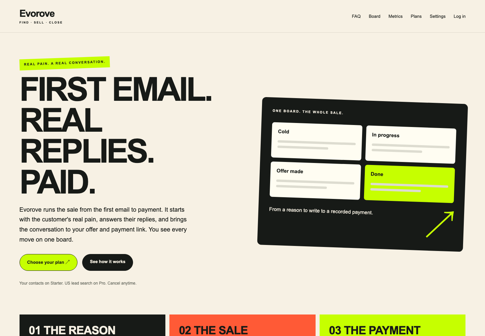
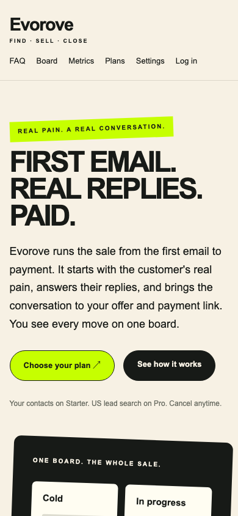

# Starter / Pro и свои контакты

Решения владельца от 3 ноября 2026 записаны в ROADMAP.md, раздел «Решения».
Ветка `feat/pricing` основана на main после fix/acceptance-core; учтён также
появившийся параллельно merge исправлений поиска `6d3268f`.

## Тарифы

- Starter — $199/месяц: email-продажа своим контактам до оплаты и Done, без поиска.
- Pro — $499/месяц: Starter + поиск компаний США с видимой болью.
- Пробного периода нет, отмена в любой момент.

Find people, GET/POST предпросмотра и его статус требуют plan=pro и status=active.
Планировщик запускает дневной поиск только для такого бизнеса; письма и IMAP
продолжают работать на Starter. На доске вместо поиска показана строка
«Lead search is included in Pro» со ссылкой на Plans.

Оболочка запуска поиска считает новые найденные people за текущие UTC-сутки
и передаёт движку остаток до 20. Свои контакты (source_url=owner) не расходуют
поисковый лимит. Повторные ручные запуски используют тот же лимит. Dry-run не
добавляет people и не расходует этот лимит. search.py не изменялся.

Plans открывает свежий Lemon Squeezy Customer Portal для изменения/отмены подписки;
локально тариф не меняется до подписанного webhook. Новые checkout используют
skip_trial=true. Владелец создаёт monthly USD-варианты 199/499 без trial и разрешает
смену вариантов в портале. Имена env-переменных Starter/Pro сохранены без значений;
инструкции добавлены в README. Внешние варианты и платежи не создавались.

## Контакты

Board → Add contacts: UTF-8 CSV или Add one. Для обоих активных тарифов.
Поля: email, name, company, website, role, us_state, note. Email и note обязательны;
note ограничена 500 символами, чтобы соответствовать существующему outreach.

- Email нормализуется; дубли проверяются без учёта регистра в пределах бизнеса.
- Стоп-лист проверяется до вставки. Чужой стоп-лист не влияет на текущий бизнес.
- Более 1000 строк отклоняются целиком до записи. Ровно 1000 разрешены.
- Ошибки отдельных строк показываются в отчёте Added / Skipped с номером и причиной.
- pain=note, evidence_quote=note, source_url="owner", stage="cold".
- Источник в карточке отображается как «Source: your note», без фиктивной URL-ссылки.
- Рассылка использует существующие outreach/guards; импорт сам не отправляет письма.

Загрузка разбирается stdlib email.parser/csv без новой зависимости. Размер HTTP-тела
ограничен при чтении; CSRF, Origin и owner-only/tenant-проверки сохранены.
Схема и миграции не менялись.

## Сайт

Английские Landing/FAQ переписаны под текущую email-продажу от реальной боли до
оффера, платёжной ссылки и записанной оплаты. Убраны прежние обещания бронирований,
триала, обучения на книгах и численных результатов продаж. В Terms убраны упоминания
триала и обновлено описание услуги. В ценах показаны две карточки Starter/Pro,
Cancel anytime и отсутствие бесплатного пробного периода.

## Проверка

- `make test`: **192 passed**.
- `make test-browser`: **6 passed**, Chromium, HTTPS, временная SQLite, без реальных
  писем, LLM-вызовов и платежей. CSV и Add one проверены через настоящий браузер.
- `make lint`, `pip check`, `git diff --check`: успешно.
- app/**/*.py: **2615 строк**, templates/static и тесты исключены.
- search.py, llm.py, outreach.py, guards.py не изменены относительно main.
- Push не выполнялся.

## Скриншоты

Полные страницы, снятые Chromium после проверки цен и отсутствия горизонтального
скролла: [Desktop 1440 px](screenshots/pricing-desktop.png),
[Mobile 390 px](screenshots/pricing-mobile.png).

Первый экран:

